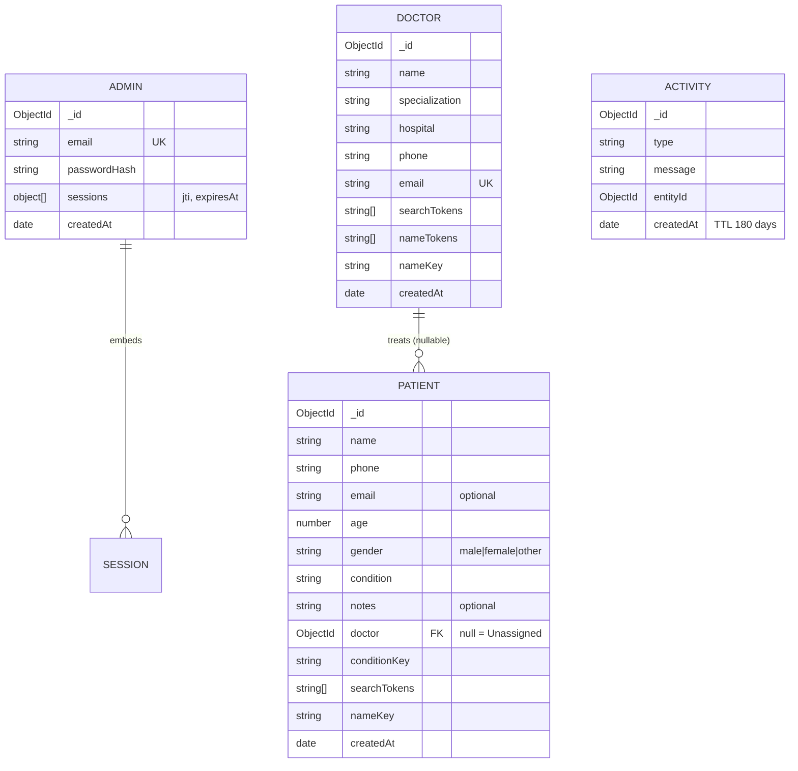

# Doctor Tracker: Backend (REST API)

Standalone Node.js + Express + TypeScript server with MongoDB (Mongoose). It exposes the REST API under `/api/v1` and has no dependency on the frontend project other than the allowed browser origin (`FRONTEND_URL`).

The matching client is the separate **doctor-tracker-frontend** project (Next.js).

## Requirements
- Node.js 22+, npm 10+
- A MongoDB server (MongoDB Atlas free tier, Docker `docker run -d -p 27017:27017 --name mongo mongo:8`, or a local install)

## Quick start
```bash
npm install
cp .env.example .env          # Windows: copy .env.example .env
# edit .env (see below), then:
npm run seed                  # creates the single administrator account
npm run seed:demo             # optional: 12 doctors + 140 patients  (npm run seed:demo -- --reset wipes and reseeds)
npm run dev                   # http://localhost:4000   (health: /api/v1/health)
```
Production: `npm run build` then `npm start`.

Generate each secret with:
```bash
node -e "console.log(require('crypto').randomBytes(48).toString('hex'))"
```

## Scripts
| Command | Purpose |
|---|---|
| `npm run dev` | start with auto-reload |
| `npm run build` / `npm start` | compile to `dist/` and run it |
| `npm run seed` | create the administrator from `ADMIN_EMAIL` / `ADMIN_PASSWORD` |
| `npm run seed:demo` | demo data (`-- --reset` to wipe first) |
| `npm run db:sync-indexes` | reconcile MongoDB indexes with the schemas |
| `npm run explain` | print `explain()` plans of the main queries |
| `npm run typecheck`, `npm run lint` | static checks |
| `npm test` | 109 integration tests (Vitest + Supertest) |

## Environment variables
### `.env`

| Variable | Purpose | Example / default |
|---|---|---|
| `PORT` | API port | `4000` |
| `NODE_ENV` | `development`, `production` or `test` | `development` |
| `MONGODB_URI` | Connection string | `mongodb://127.0.0.1:27017/doctor-tracker` |
| `JWT_ACCESS_SECRET` | Signs access tokens (≥ 32 chars) | random |
| `JWT_REFRESH_SECRET` | Signs refresh tokens; must differ from the access secret | random |
| `COOKIE_SECRET` | Signs the CSRF token | random |
| `ACCESS_TOKEN_EXPIRES_IN` | Access-token lifetime | `15m` |
| `REFRESH_TOKEN_EXPIRES_IN` | Refresh-token lifetime ("remember me") | `7d` |
| `FRONTEND_URL` | Allowed CORS and CSRF origin | `http://localhost:3000` |
| `ADMIN_EMAIL` | Seeded administrator email | |
| `ADMIN_PASSWORD` | Seeded administrator password (≥ 12 chars, upper, lower, digit). **Quote it** if it contains `#`. | `"ChangeMe!12345"` |
| `APP_TIMEZONE` | IANA timezone used for dashboard day/week/month boundaries | `UTC` |
| `TRUST_PROXY` | Set when running behind a reverse proxy | `false` |
| `LOG_LEVEL` | pino level | `info` |

## Connecting a frontend
- Set `FRONTEND_URL` to the exact origin of the web app (for example `http://localhost:3000`). CORS and the CSRF origin check allow only this origin.
- Authentication uses HttpOnly cookies, so the frontend must send requests with credentials. Deploy the two apps on the same site (for example `app.example.com` and `api.example.com`); cross-site deployment would need `SameSite=None; Secure` and a revised CSRF design.
- Unsafe requests (POST, PATCH, DELETE) must send the `X-CSRF-Token` header, whose value is the `csrf_token` cookie value. The Next.js client in this delivery does this automatically.

## Database design



A patient references one doctor; a doctor's patient count is computed, not stored, so it can never drift. `Activity` is an independent, self-expiring log that feeds the "recent activity" panel.

### Indexes

| Collection | Index | Serves |
|---|---|---|
| doctors | `email` (unique) | duplicate prevention |
| doctors | `searchTokens`, `nameTokens` (multikey) | prefix search |
| doctors | `createdAt -1` | default list order, recent additions, trend buckets |
| doctors | `{specialization, createdAt}`, `{hospital, createdAt}` | filtered lists |
| doctors | `nameKey` | sort by name |
| patients | `{doctor, createdAt}` | a doctor's patient list, per-doctor counts |
| patients | `{conditionKey, createdAt}` | condition filter and distribution |
| patients | `searchTokens` | prefix search |
| patients | `createdAt`, `age`, `nameKey` | sorting and age range |
| admins | `email` (unique), `sessions.jti` | login, refresh lookup |
| activities | `createdAt` (TTL) | newest-first feed and automatic expiry |

Gender is deliberately not indexed: with three values it is not selective, and it is always combined with other conditions. `npm run explain` prints the plans and shows index scans (`IXSCAN`) rather than collection scans for the main list, search, filter and dashboard queries.

## API reference

Base path `/api/v1`. All routes except `/health` and `/auth/login` require authentication. Unsafe methods (POST, PATCH, DELETE) additionally need the `X-CSRF-Token` header (the web client does this automatically).

| Method | Path | Description |
|---|---|---|
| GET | `/health` | liveness |
| POST | `/auth/login` | `{ email, password, rememberMe }` → sets cookies |
| POST | `/auth/refresh` | rotate the refresh token |
| POST | `/auth/logout` | revoke the session, clear cookies |
| GET | `/auth/me` | current administrator |
| POST | `/doctors` | create a doctor |
| GET | `/doctors` | list: `page, limit, search, specialization, hospital, sortBy, sortOrder` |
| GET | `/doctors/options` | compact list for dropdowns |
| GET | `/doctors/filter-options` | distinct specializations and hospitals |
| GET | `/doctors/:id` | details and patient count |
| GET | `/doctors/:id/patients` | that doctor's patients (same query options as `/patients`) |
| POST | `/doctors/:id/patients` | create a patient under the doctor |
| DELETE | `/doctors/:id/patients/:patientId` | remove from the doctor (patient becomes Unassigned) |
| POST | `/patients` | create |
| GET | `/patients` | list: `page, limit, search, doctorId (or "unassigned"), gender, condition, ageMin, ageMax, sortBy, sortOrder` |
| GET | `/patients/filter-options` | distinct conditions |
| GET | `/patients/:id` | details |
| PATCH | `/patients/:id` | update |
| DELETE | `/patients/:id` | delete |
| GET | `/dashboard/overview` | totals, average, monthly deltas |
| GET | `/dashboard/patients-per-doctor` | `limit` |
| GET | `/dashboard/trends` | `period=daily|weekly|monthly`, `from`, `to` |
| GET | `/dashboard/conditions` | distribution, tail rolled into "Other" |
| GET | `/dashboard/recent-activity` | `limit` |

Paginated responses: `{ success: true, data: [...], meta: { page, limit, total, totalPages } }`.
Status codes: `400` malformed input, `401` unauthenticated, `403` CSRF/origin failure, `404` not found, `409` duplicate email, `422` validation error, `429` rate limited.

## Technical decisions

### 1. Token-prefix search instead of regex scans

A naive `name: /term/i` search cannot use an index, so it reads every document. Each doctor and patient stores lower-cased, accent-folded `searchTokens`. A query is split into tokens and each token becomes an anchored `^token` regular expression against the multikey index; multiple tokens are ANDed. Anchored prefix patterns can use index bounds, so the cost depends on the number of matches, not on the collection size. The trade-off is that matching is by word prefix ("card" finds *Cardiology*) rather than by arbitrary substring ("iolog" does not), which is the behaviour people expect from a directory search. Input is escaped (so `.*` cannot match everything), blank input means "no search" and punctuation-only input matches nothing. Searching patients by their doctor's name first resolves matching doctor ids (capped at 100) and then filters on `doctor ∈ ids`.

### 2. Rotating refresh tokens in HttpOnly cookies, with CSRF defence

Tokens are never exposed to JavaScript and never placed in `localStorage`, which removes the main XSS token-theft path. Because cookies are sent automatically, cross-site request forgery is handled explicitly: `SameSite=Lax`, an Origin allow-list check, and a signed double-submit token for unsafe methods. Refresh tokens rotate on every use; the new token is swapped in with one atomic `findOneAndUpdate`, so two concurrent refreshes cannot both succeed. Presenting an already-rotated token is treated as theft and revokes the whole token family. The refresh and logout endpoints check the Origin but not the CSRF token, because after a page reload the in-memory token is gone and the session must still be recoverable; this was found and fixed through a real browser test and is covered by regression tests. The Axios client serialises refreshes (single flight) so a burst of 401s causes one refresh and then retries.

### 3. No N+1 queries for doctor lists

The doctor list is one aggregation: filter, sort, skip and limit first (so only one page of doctors is processed), then a `$lookup` with a `$count` sub-pipeline into the patient `{doctor, createdAt}` index for the patient counts. The row count and the page are fetched in parallel; the unfiltered total uses `estimatedDocumentCount`.

### 4. Time zone aware analytics

"This month", daily/weekly/monthly buckets and the default 30-day window follow `APP_TIMEZONE`, not UTC, so a patient registered at 01:00 local time is counted on the right day. Series are zero-filled so charts have no gaps, weeks start on Monday, and a cap on the number of buckets prevents a huge range from producing a huge response.

### 5. Doctors without update/delete, patients that can become unassigned

The brief forbids editing or deleting doctors. Removing a patient from a doctor is therefore modelled as `doctor = null` ("Unassigned") rather than deletion, and the patient list can filter on it. Creating or editing a patient always requires a valid doctor.

## Performance

- Server-side pagination everywhere (default 10, maximum 100 rows) with an `_id` tie-breaker so pages never overlap or skip.
- Indexed filters and sorts; plans verified with `explain()`.
- List queries run `find` and `countDocuments` in parallel.
- Dashboard aggregations are cached in-process for 30 seconds with request coalescing (concurrent identical requests share one query) and are invalidated by every create, update and delete, so the numbers are never stale after a change. The cache is disabled in tests.
- Responses are gzip-compressed; request bodies are limited to 100 KB.
- Frontend: search is debounced (350 ms), previous data stays visible while the next page loads (`keepPreviousData`), charts are loaded lazily and only on the dashboard, fonts are bundled (no network font requests), links in tables do not prefetch.

## Security

- Passwords hashed with bcrypt (12 rounds); login runs a dummy comparison for unknown emails so response time does not reveal which emails exist; the same message is returned for a wrong email and a wrong password.
- HS256 JWTs with separate secrets for access and refresh tokens, issuer and audience claims, short access lifetime.
- HttpOnly, `SameSite=Lax` cookies (`Secure` in production); the refresh cookie is scoped to `/api/v1/auth`.
- CSRF protection (Origin check + signed double-submit token); CORS limited to `FRONTEND_URL` with credentials.
- Helmet security headers; rate limits (300 requests/min general, 10 logins/15 min, 100 session calls/15 min).
- Zod validation of every body, query and path parameter; MongoDB operator injection (`$`/`.` keys) is rejected; regular expressions built from input are escaped; ids are validated as ObjectIds.
- No public registration route; the administrator is created by `npm run seed`, which enforces a password policy.
- Logs redact cookies, authorization headers and passwords; internal errors never leak stack traces in responses.
- Secrets live only in git-ignored `.env` files.

## Testing
```bash
npm test                                        # uses an in-memory MongoDB (downloaded on first run)
TEST_MONGODB_URI=mongodb://127.0.0.1:27017 npm test   # or reuse a MongoDB you already run
```
Last run: **109 passed, 0 failed** (4 files). Each run uses its own throw-away database (`doctor-tracker-test-<pid>`), never your real data. Typecheck, lint and build are clean.

Covered: authentication (login, wrong credentials, no user enumeration, refresh rotation and reuse detection, logout, remember-me, CSRF and origin checks, no registration route), doctor and patient rules, validation, duplicates, search, filters, sorting, pagination, operator-injection rejection, the doctor/patient relationship, and every dashboard endpoint including time-zone bucketing and cache invalidation.

## Known limitations
- Dashboard cache and rate limiter are per process; several instances need a shared store such as Redis.
- Single administrator role; no user management.
- Cookies are `SameSite=Lax` (same-site deployment).
